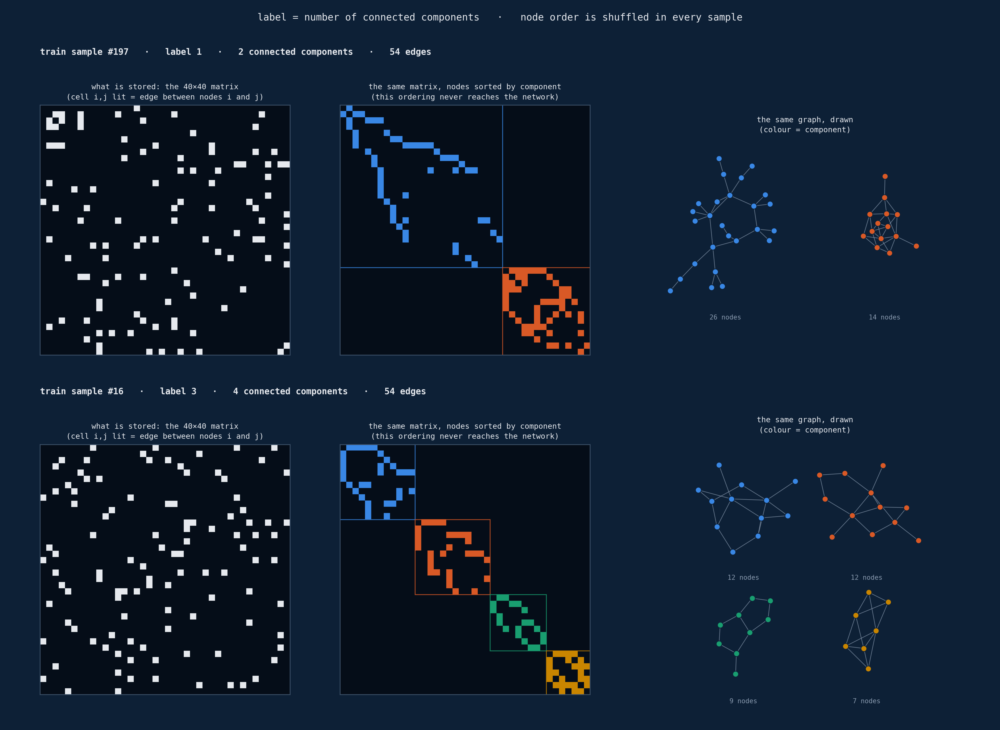
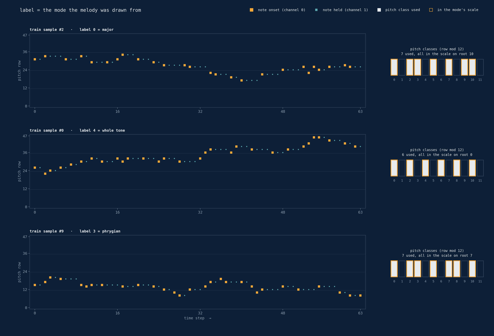
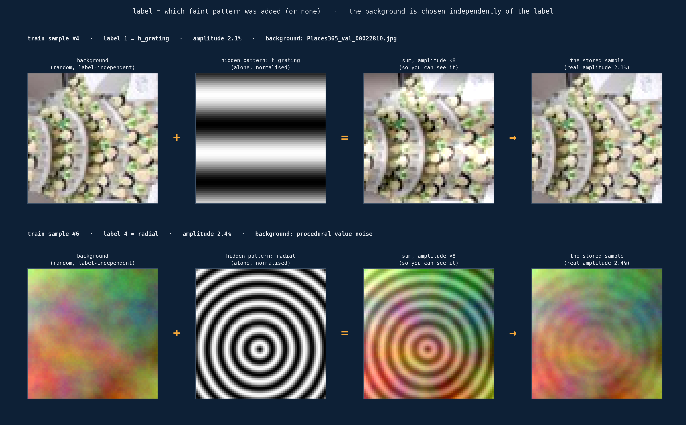
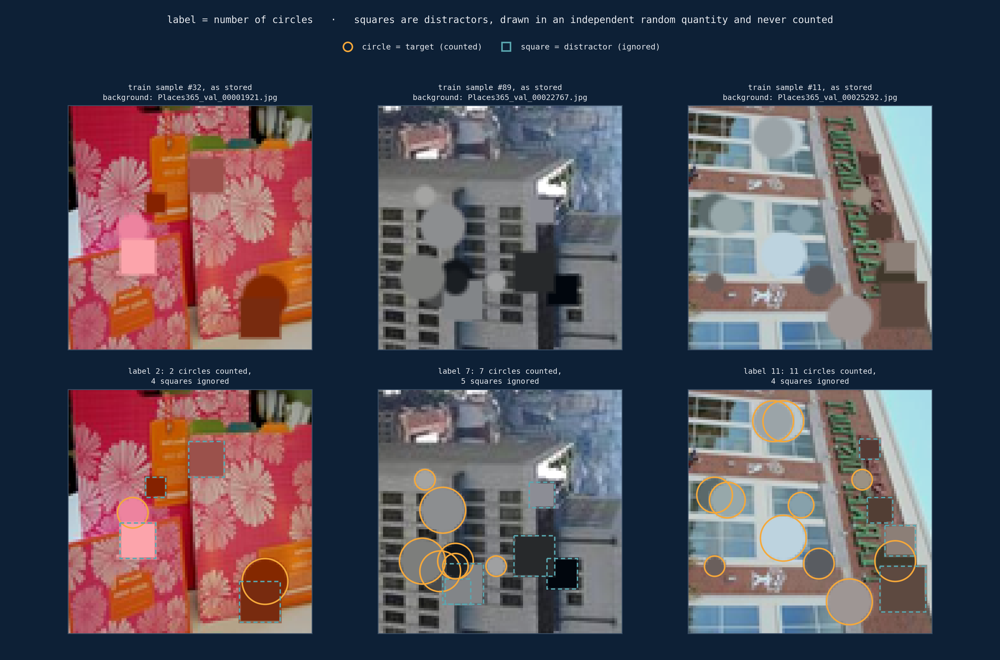
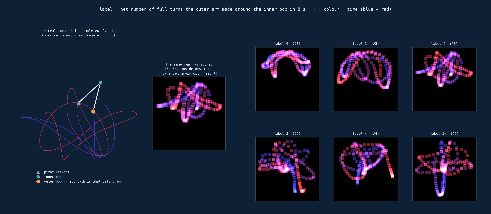

# Five arrays shaped like images

*Five synthetic classification datasets stored as image tensors — none of them are photographs.*

Every dataset here has the outer shell of an ordinary image dataset: `float32` tensors of
shape `(C, H, W)` with values in `[0, 1]`, one to three channels, integer class labels.
What is actually stored inside is a graph, a melody, a hidden signal, a scene built to hide
a count, or the trace of a chaotic simulation. That mismatch is the point: the datasets
test whether a neural architecture search, an AutoML system or a hand-designed network can
cope with image-shaped data that does not behave like photographs.

| Dataset | Shape (C×H×W) | Classes | Label | The catch |
|---|---|--:|---|---|
| [GraphSpectra](#graphspectra) | 1×40×40 | 8 | connected components of a graph | pixel position means nothing |
| [MelodyContour](#melodycontour) | 2×48×64 | 6 | musical mode of a melody | label is modular arithmetic over rows |
| [HiddenSignal](#hiddensignal) | 3×64×64 | 6 | which faint pattern was added | label is decoupled from visible content |
| [CamoCount](#camocount) | 3×96×96 | 13 | number of camouflaged circles | count weak objects, ignore distractors |
| [PendulumChaos](#pendulumchaos) | 3×64×64 | 6 | turns of a double pendulum | topological property of a chaotic trajectory |

All five: 35,000 samples split 25,000 / 5,000 / 5,000 (train / valid / test), balanced
classes, generated from scratch by one script each.

**Contents**

- [Generating the datasets](#generating-the-datasets)
  - [Requirements](#requirements) · [Commands](#commands) · [Options](#options) ·
    [Output format](#output-format) · [Reproducibility](#reproducibility) ·
    [Figures](#regenerating-the-figures)
- [The datasets](#the-datasets)
  - [GraphSpectra](#graphspectra) · [MelodyContour](#melodycontour) ·
    [HiddenSignal](#hiddensignal) · [CamoCount](#camocount) · [PendulumChaos](#pendulumchaos)
- [Photo backgrounds](#photo-backgrounds-hiddensignal-camocount)
- [Repository layout](#repository-layout)

---

## Generating the datasets

### Requirements

- Python 3.12 or newer (tested with 3.14)
- `numpy` and `Pillow` for the generators, `matplotlib` only for `make_figures.py`
- ~8.4 GB of disk space for all five datasets, plus ~550 MB for the photo cache
- Network access once, for the photo download used by HiddenSignal and CamoCount

```bash
pip install -r requirements.txt
```

### Commands

Every dataset has its own script, run from this directory. Without flags a script runs a
**smoke test**: it builds a few hundred samples in memory, checks shapes, value ranges,
class balance and a dataset-specific correctness property, and writes nothing to disk.
With `--full` it builds the full 35,000 samples and saves them to `data/<Name>/`.

```bash
python generate_graphspectra.py --full
python generate_melodycontour.py --full
python generate_hiddensignal.py --full     # first run downloads the photos (~525 MB)
python generate_camocount.py --full        # reuses the same photo cache
python generate_pendulumchaos.py --full
```

All five in one go:

```bash
for name in graphspectra melodycontour hiddensignal camocount pendulumchaos; do
    python generate_$name.py --full
done
```

| Script | Writes to | Time¹ | On disk | Network |
|---|---|--:|--:|---|
| `generate_graphspectra.py` | `data/GraphSpectra/` | 41 s | 0.22 GB | — |
| `generate_melodycontour.py` | `data/MelodyContour/` | 13 s | 0.86 GB | — |
| `generate_hiddensignal.py` | `data/HiddenSignal/` | 56 s | 1.72 GB | Places365 photos, once |
| `generate_camocount.py` | `data/CamoCount/` | 129 s | 3.87 GB | Places365 photos, once |
| `generate_pendulumchaos.py` | `data/PendulumChaos/` | 44 s | 1.72 GB | — |

¹ Single process on a desktop CPU, photos already cached. Downloading and unpacking the
photos added about 35 s on a fast connection.

### Options

All scripts share the same command line:

| Option | Default | Meaning |
|---|---|---|
| `--full` | off | build and save the full dataset (otherwise: in-memory smoke test) |
| `--seed N` | `0` | random seed; the same seed always produces the same dataset |
| `--out DIR` | `data/<Name>/` | where to write the files |
| `--cache-dir DIR` | `.image_cache/` | HiddenSignal and CamoCount only: where the photos are kept |

The first HiddenSignal or CamoCount run downloads the Places365 validation set
(`val_256.tar`, ~525 MB), unpacks its 36,500 JPEGs into
`.image_cache/places365_val_256/` and deletes the archive. Every later run of either script
reuses that folder without touching the network. Each step lands through an atomic rename,
so an interrupted download or extraction is simply redone on the next run. Details on how
the photos are used are in [Photo backgrounds](#photo-backgrounds-hiddensignal-camocount).

### Output format

```
data/<Name>/
├── train_x.npy    (25000, C, H, W)  float32 in [0, 1]
├── train_y.npy    (25000,)          int64 in [0, num_classes)
├── valid_x.npy    (5000, C, H, W)
├── valid_y.npy    (5000,)
├── test_x.npy     (5000, C, H, W)
├── test_y.npy     (5000,)
└── metadata       single-line JSON
```

Example `metadata` (HiddenSignal):

```json
{"num_classes": 6, "input_shape": [25000, 3, 64, 64], "codename": "HiddenSignal",
 "benchmark": 0.0, "class_names": ["none", "h_grating", "v_grating", "d_grating", "radial",
 "checkerboard"], "photo_source": "places365_val_256"}
```

| Key | Meaning |
|---|---|
| `num_classes` | number of classes |
| `input_shape` | shape of `train_x.npy` |
| `codename` | dataset name |
| `benchmark` | reference accuracy for score normalisation; `0.0` = no reference published yet |
| `class_names` | label names, where the labels have names (MelodyContour, HiddenSignal, PendulumChaos) |
| `photo_source` | photo set used for backgrounds (HiddenSignal, CamoCount) |

The layout follows the data format of the NAS Unseen-Data Challenge, so the datasets drop
into tooling built for it. Loading one in Python:

```python
import json
import numpy as np

d = "data/HiddenSignal"
x_train = np.load(f"{d}/train_x.npy", mmap_mode="r")   # (25000, 3, 64, 64)
y_train = np.load(f"{d}/train_y.npy")                   # (25000,)
meta = json.load(open(f"{d}/metadata"))
```

### Reproducibility

Generation is fully deterministic: the same `--seed` produces byte-identical arrays on
every run. HiddenSignal and CamoCount additionally decode JPEG photos, and different
Pillow/libjpeg builds may decode a pixel differently in the last bit, so byte-identical
output across machines is only guaranteed with the same Pillow version.

### Regenerating the figures

The figures in [`images/`](images/) are rendered from **real training samples** of the
`--full`, seed-0 datasets. Generate all five datasets first, then:

```bash
python make_figures.py                   # all five figures
python make_figures.py camocount         # only some of them
```

Some figures need internals that are not stored: HiddenSignal's clean background and
hidden pattern, CamoCount's shape positions, PendulumChaos's trajectory. For these,
`make_figures.py` re-runs the generator with hooks just until the shown samples exist,
and checks that every replayed sample is byte-identical to the saved one.

---

## The datasets

### GraphSpectra

*An image that is secretly a graph.*

Each sample is a 40×40 grid of zeros and ones. It looks like a small, noisy black-and-white
image, but row and column *i* both stand for node *i* of a 40-node undirected graph, and a
lit cell `(i, j)` means "node *i* and node *j* are connected". It is an adjacency matrix
wearing an image's clothes: symmetric, with an empty diagonal.

The label is **how many connected components** the graph has, 1 to 8. The node order is
**randomly reshuffled in every sample**. Sorted by component, the matrix would show one
clean block per component along the diagonal. Shuffled, which is how it is stored, the
same graph is a scatter of dots that gives a convolution filter nothing to hold on to:
whether two lit cells are related depends on which row and column they share, not on how
close they are.



*Two real training samples, #197 (2 components) and #16 (4 components). They were picked
among the sparser graphs so the drawing stays legible; a typical sample has many more
extra edges (median about 128 on top of the spanning trees for two components, 52 for
four). Left: what is stored. Middle: the same matrix with the nodes grouped by component,
an ordering the network never sees. Right: the graph itself, coloured by component.*

**How it is generated** ([`generate_graphspectra.py`](generate_graphspectra.py)). For a
target count *k*: split the 40 nodes into exactly *k* non-empty groups, wire each group
into a random spanning tree (so it is connected), add a random number of extra edges
inside each group, add no edges between groups, then permute the node order. The
component count equals *k* by construction, so no rejection sampling is needed and the
classes are perfectly balanced. The smoke test re-counts the components of 40 samples
with an independent breadth-first search.

> **The catch:** convolution assumes nearby pixels are related; here pixel adjacency
> carries no meaning at all, and the label has to survive any permutation of the nodes.

| | |
|---|---|
| shape | `(1, 40, 40)` |
| classes | 8; label *c* means *c* + 1 connected components |
| values | `{0, 1}`, symmetric, zero diagonal |

---

### MelodyContour

*Music made visible, then asked to be seen as a picture anyway.*

This one is almost entirely black, with a scatter of small bright marks: about 98.5% of
the grid is zero. Read the two axes literally: **height is pitch** (48 semitones, four
octaves, low at the bottom), **width is time** (64 steps). Channel 0 lights up the step a
note starts; channel 1 stays lit for as long as it is held. It is a piano-roll, the kind
of grid a sequencer draws, not a camera.

Each melody is a random walk. Pick a mode (major, natural minor, dorian, phrygian, whole
tone or major pentatonic) and a root note, then wander up and down the mode's *scale
degrees*, never raw semitones, so every note the walk lands on belongs to that mode. The
label is **which of the six modes generated the melody**.

The tell is not a shape but arithmetic: which pitch *classes* (row index modulo 12) are
ever lit. Transpose a melody by a few semitones and it becomes a different-looking grid
with the same label; change its rhythm and every lit column moves.



*Three real training samples: #2 (major), #0 (whole tone) and #9 (phrygian). Right of
each piano-roll: the pitch classes the melody uses (filled) and the mode's scale on a
root that contains them all (orange outline). The whole-tone melody can only ever use
every second pitch class.*

**How it is generated** ([`generate_melodycontour.py`](generate_melodycontour.py)). Pick
a mode and a random root, start on a random scale degree and take a random walk with
steps of −2 to +2 degrees. Each note gets a random duration of 1–4 steps until the 64 steps are
filled; a walk that leaves the 48-row range is re-centred. Because the walk moves over
degrees, the same code handles the 5-, 6- and 7-note modes without special cases.

> **The catch:** the label depends on a modular-arithmetic pattern in *which rows* ever
> light up, not on any blob, edge or texture, and must survive transposition.

| | |
|---|---|
| shape | `(2, 48, 64)`: channel 0 = onsets, channel 1 = held notes |
| classes | 6: `major`, `natural_minor`, `dorian`, `phrygian`, `whole_tone`, `major_pentatonic` |
| values | `{0, 1}`, ~98.5% zero |

---

### HiddenSignal

*The picture is a decoy. The label lives in the noise floor.*

This is the one that looks completely ordinary: a crop of a real photo or a soft
procedural texture, full colour, nothing structurally unusual. That is deliberate: the
background is drawn **independently of the label**. What decides the class is a faint
periodic ripple added on top at 1.5–3.5% amplitude: a horizontal grating, a vertical
one, a diagonal one, a radial ripple around a random centre, a fine checkerboard, or
nothing at all.

The figure exaggerates the ripple eight times so its shape becomes visible. The stored
sample looks like the last column, which is practically indistinguishable from the plain
background. A model that is good at recognising photo content learns nothing useful
here, because content and label are uncorrelated by construction. It has to pick up a
specific low-amplitude periodic residual instead: closer to a narrowband frequency
detector than an image classifier.



*Row 1: training sample #4, a horizontal grating on a Places365 photo. Row 2: training
sample #6, a radial ripple on a procedural texture. The first three columns are
reconstructed by replaying the generator; the last column is the stored sample.*

**How it is generated** ([`generate_hiddensignal.py`](generate_hiddensignal.py)). Each
background is, with equal probability, a photo crop (see
[Photo backgrounds](#photo-backgrounds-hiddensignal-camocount)) or a fractal value-noise
texture. A per-class formula produces the carrier with randomised frequency and phase, it
is scaled by a random amplitude between 1.5% and 3.5%, added and clipped to `[0, 1]`. The
smoke test confirms on a same-seed clean/signal pair that the embedded signal is present
but subtle (mean absolute difference between 0.0005 and 0.05).

| Label | Name | Pattern |
|--:|---|---|
| 0 | `none` | nothing added |
| 1 | `h_grating` | sin(2π·f·y + φ), f = 2–4 cycles per image |
| 2 | `v_grating` | sin(2π·f·x + φ), same band |
| 3 | `d_grating` | 45° grating, f = 5–8 |
| 4 | `radial` | sin(2π·f·r + φ) around a random centre, f = 6–10 |
| 5 | `checkerboard` | sign(sin(2π·fx·x)·sin(2π·fy·y)), fx, fy = 14–20 (near Nyquist) |

> **The catch:** the label is decoupled from the visible content: two images with the
> same content can carry different labels, and two very different images the same one.

| | |
|---|---|
| shape | `(3, 64, 64)` |
| classes | 6: pattern type, or none |
| signal amplitude | 1.5–3.5% of the value range |
| backgrounds | 50% Places365 photo crops, 50% procedural noise |

---

### CamoCount

*Count what blends in. Ignore what does not belong.*

Another photo-or-texture background, but this time it is not empty. A handful of soft,
low-contrast blobs are scattered across it, each coloured to sit close to its own local
backdrop rather than to stand out: camouflage, not a bold foreground object. Two shapes
appear. **Circles** are what the label counts. **Squares** are drawn in an independent
random quantity every time; they are never counted and have to be actively ignored.

The label is simply the circle count, 0 to 12. Three hard problems stack at once: the
number of relevant objects is unknown in advance, each one is only weakly visible
against its background, and a distractor of the same family has to be filtered out by
its shape alone, not by "is there something here".



*Three real training samples, #32, #89 and #11, with 2, 7 and 11 circles. The
annotations come from the generator's own shape list, recovered by replaying it. The
square count is drawn independently and never enters the label.*

**How it is generated** ([`generate_camocount.py`](generate_camocount.py)). For a target
count, draw that many circles plus 0–8 squares, shuffle their drawing order and place
each at a random position with a radius of 3–8 pixels. Each shape is alpha-blended with a
soft two-pixel edge; its colour is the mean of the background patch it covers plus a
random contrast offset of 8–25% with random sign, so shapes may partially hide each
other.

> **The catch:** counting a variable number of low-salience objects, with a same-family
> distractor that must be filtered by shape, not by presence.

| | |
|---|---|
| shape | `(3, 96, 96)` |
| classes | 13: circle count 0–12 |
| distractors | 0–8 squares per scene, independent of the label |
| backgrounds | 50% Places365 photo crops, 50% procedural noise |

---

### PendulumChaos

*A butterfly-effect machine, rendered as one still frame.*

Two rigid arms hang from a fixed pivot: an ordinary double pendulum, simulated for 8
seconds from a random starting pose. What gets stored is not the simulation but the path
the outer bob traces: a single 64×64 curve, coloured from blue (start) to red (end) so
the direction of travel survives being flattened into one image.

The label is the **net number of full turns the outer arm made around the inner bob**
during those 8 seconds, from 0 to "5 or more". It is read directly off the physics, not
estimated from the picture. Because a double pendulum is chaotic, two runs that start
almost identically can end in different classes, while two very different-looking
trails can share one. Nothing about the image looks "encoded" (it is a smooth,
natural-looking curve), yet the label is a global, topological fact about the trajectory
that local texture does not reveal.



*Left: training sample #0 (label 2) in physical coordinates, with the arms at t = 0 and
the outer bob's path coloured by time; next to it, the same run as stored. The stored
image is upside down relative to the physics (the image row index grows with height).
Right: the first training sample of each label.*

**How it is generated** ([`generate_pendulumchaos.py`](generate_pendulumchaos.py)). Equal
masses and arm lengths, standard Lagrangian equations of motion, fixed-step RK4 with
dt = 0.02 s for 400 steps, starting angles uniform in [−π, π] and angular velocities in
[−0.5, 0.5] rad/s. All runs of a batch are integrated together as numpy arrays. The turn
count is `floor(|θ₂(end) − θ₂(start)| / 2π)` on the unwrapped outer angle, so it is
exact, and turns back and forth cancel. The natural distribution is heavily skewed
(about 60% of random starts never complete a turn, about 2.5% reach five), so batches are
simulated until every class quota is filled. Every second step of the trajectory is then
drawn as a 3×3 dot, colours adding up where the path overlaps itself.

> **The catch:** the label is a topological property of a chaotic trajectory, not a
> local visual feature, and nearby-looking inputs can disagree completely.

| | |
|---|---|
| shape | `(3, 64, 64)` |
| classes | 6: `0`, `1`, `2`, `3`, `4`, `5+` net turns |
| simulated span | 8 s, RK4, dt = 0.02 s |

---

## Photo backgrounds (HiddenSignal, CamoCount)

Half of the backgrounds of HiddenSignal and CamoCount are crops of real photos from the
**Places365 validation set**: 36,500 scene photos at 256×256 px, downloaded from
`data.csail.mit.edu`. The other half are procedural value-noise textures.

- **Many photos, no repeats.** The photo set is shuffled and cut into disjoint train /
  valid / test shares proportional to the split sizes (26,071 / 5,214 / 5,215). Each
  share is larger than the number of photo backgrounds its split needs (~12,600 /
  ~2,500 / ~2,500), so every photo sample uses its own photo, and no photo appears in
  two splits. A model cannot memorise the backgrounds.
- **Never upsampled.** A square crop with a side between the target size and 256 px is
  downsampled to 64 or 96 px. Upscaled low-resolution photos (CIFAR-style 32×32, for
  example) have almost no high-frequency content, which would make HiddenSignal's fine
  patterns trivially visible.
- **Augmentation** per crop: random horizontal and vertical flips, a random 90° rotation
  and a mild brightness (±0.1) and contrast (×0.85–1.15) jitter.

The download, cache and crop code lives in each of the two generator scripts, so either
one works on its own; they share only the cache folder.

The Places365 images are provided by their authors for non-commercial research and
education; check the [Places365 terms](http://places2.csail.mit.edu/) before
redistributing generated HiddenSignal or CamoCount data, since it contains crops of
those images. Places365: B. Zhou, A. Lapedriza, A. Khosla, A. Oliva and A. Torralba,
"Places: A 10 Million Image Database for Scene Recognition", *IEEE TPAMI*, 2017.

---

## Repository layout

```
.
├── README.md
├── requirements.txt
├── common.py                    # file layout, balanced labels, value-noise texture
├── generate_graphspectra.py     # one self-contained script per dataset
├── generate_melodycontour.py
├── generate_hiddensignal.py
├── generate_camocount.py
├── generate_pendulumchaos.py
├── make_figures.py              # renders images/ from the generated datasets
├── images/                      # figures used in this README
├── data/                        # generated datasets (not in git)
└── .image_cache/                # Places365 photos (not in git)
```
